# Economy GUI Guide


> Every screen in the **Economy** Paper plugin, rendered with the actual Minecraft container textures, item textures and bitmap font extracted from the client jar.

The previews below are not hand-drawn mockups. They are generated by [`generate_gui_docs.py`](../.agent-work/tools/generate_gui_docs.py), which reads:

- `assets/minecraft/textures/gui/container/generic_54.png` for the container background
- `assets/minecraft/textures/item/*.png` and `block/*.png` for every item icon
- `assets/minecraft/textures/font/ascii.png` for the title text

The item names, lore, slot numbers and navigation controls match the Java sources in [`src/main/java/minecraft/economy`](../src/main/java/minecraft/economy). Slots are inventory slots (0 is the top-left slot).

## Screen Flow

```text
/shop -> Economy Shop
  +-- category button or compass -> Category browser -> Buy confirmation
  +-- Buy Catalog -> Buy confirmation
  +-- Sell Chest -> close to sell
  +-- Auction House -> listing -> Confirm purchase
/buy [search] -> Buy Catalog / Search results -> Buy confirmation
/sell -> Sell Chest
/ah -> Auction House -> Confirm purchase
```

---

## 1. Economy Shop

**Opened by:** `/shop`  
**Inventory size:** 6 rows (54 slots)

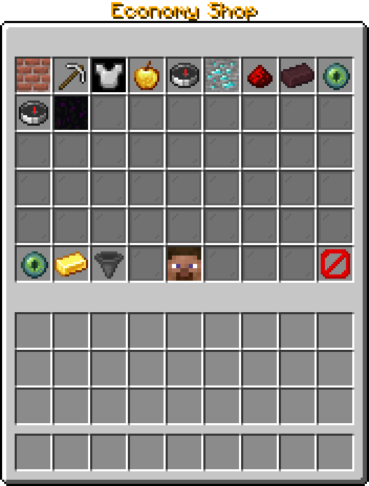

The root menu. Category buttons are arranged around the compass shortcut to **All Items**, with utility screens along the bottom row.

| Icon | Slot | Item / control | Lore / action |
|:---:|:---:|:--|:--|
| 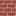 | `0` | **Blocks** | Browse blocks items<br>Click to browse |
| 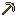 | `1` | **Tools** | Browse tools items<br>Click to browse |
|  | `2` | **Armor** | Browse armor items<br>Click to browse |
|  | `3` | **Food** | Browse food items<br>Click to browse |
|  | `4` | **All Items** | Browse all shop items<br>Click to browse |
| 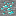 | `5` | **Ores** | Browse ores items<br>Click to browse |
|  | `6` | **Redstone** | Browse redstone items<br>Click to browse |
| 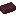 | `7` | **Nether** | Browse nether items<br>Click to browse |
|  | `8` | **End** | Browse end items<br>Click to browse |
|  | `9` | **Misc** | Browse misc items<br>Click to browse |
| 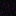 | `10` | **Rare** | Browse rare items<br>Click to browse |
|  | `45` | **Auction House** | Buy and sell items with other players<br>Click to open |
|  | `46` | **Buy Catalog** | Browse the catalog by item family<br>Click to open |
|  | `47` | **Sell Chest** | Drop items in, close the chest<br>and they are sold!<br>Click to open |
| 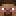 | `49` | **Steve \| Profile** | Balance: $1M<br>($1,000,000)<br>-------------------------<br>Account active |
|  | `53` | **Close** | Close this menu |

---

## 2. Shop: Blocks (1/22)

**Opened by:** `/shop`  
**Inventory size:** 6 rows (54 slots)

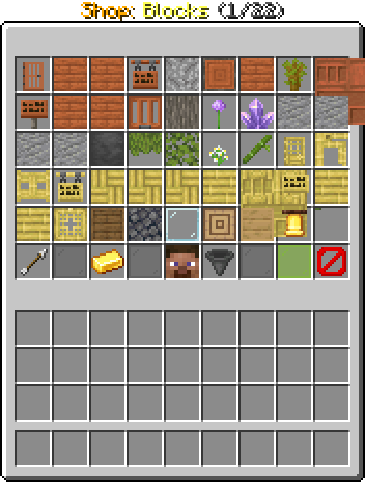

Category pages show 45 shop entries. This sample is the first page of **Blocks** (970 items, 22 pages).

| Icon | Slot | Item / control | Lore / action |
|:---:|:---:|:--|:--|
| 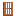 | `0` | **Acacia Door** | Category: blocks<br>Buy price: $1.6K<br>Sell price: $400<br>-------------------------<br>▶ Left-Click: Buy 1x<br>▶ Right-Click: Select quantity |
|  | `1` | **Acacia Fence** | Category: blocks<br>Buy price: $1.2K<br>Sell price: $300<br>-------------------------<br>▶ Left-Click: Buy 1x<br>▶ Right-Click: Select quantity |
| 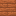 | `2` | **Acacia Fence Gate** | Category: blocks<br>Buy price: $1.2K<br>Sell price: $800<br>-------------------------<br>▶ Left-Click: Buy 1x<br>▶ Right-Click: Select quantity |
|  | `3` | **Acacia Hanging Sign** | Category: blocks<br>Buy price: $2K<br>Sell price: $1.6K<br>-------------------------<br>▶ Left-Click: Buy 1x<br>▶ Right-Click: Select quantity |
| 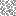 | `4` | **Acacia Leaves** | Category: blocks<br>Buy price: $500<br>Sell price: $400<br>-------------------------<br>▶ Left-Click: Buy 1x<br>▶ Right-Click: Select quantity |
| 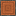 | `5` | **Acacia Log** | Category: blocks<br>Buy price: $800<br>Sell price: $600<br>-------------------------<br>▶ Left-Click: Buy 1x<br>▶ Right-Click: Select quantity |
| 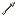 | `45` | **« Back** | Return to previous screen |
|  | `47` | **Buy Catalog** | Catalog grouped by item family |
|  | `49` | **Steve \| Profile** | Balance: $1M<br>($1,000,000)<br>-------------------------<br>Account active |
|  | `50` | **Sell Chest** | Drop items in, close to sell |
|  | `52` | **Next Page »** | Page 2 |
|  | `53` | **Close** | Close this menu |
|  | `...` | **39 more dynamic entries** | Rendered in the same slots in-game. |

---

## 3. Buy Catalog | All Items (1/43)

**Opened by:** `/buy`  
**Inventory size:** 6 rows (54 slots)

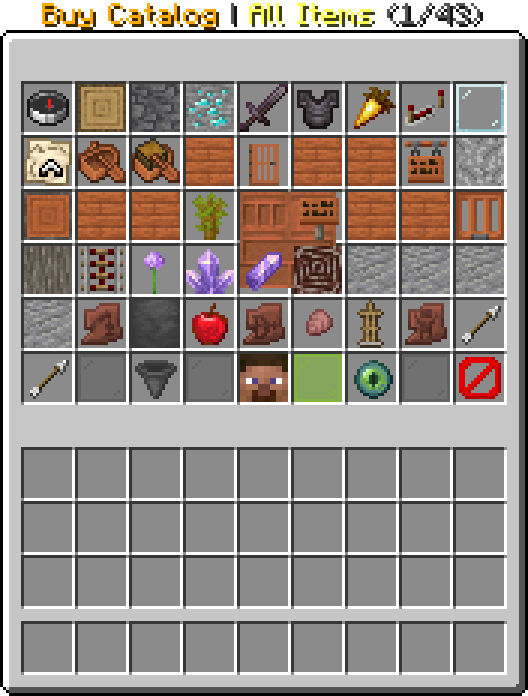

The tabbed catalog. Tabs occupy the top row and 36 buyable entries fill slots 9-44 (1539 buyable items, 43 pages).

| Icon | Slot | Item / control | Lore / action |
|:---:|:---:|:--|:--|
|  | `0` | **▶ All Items** | Currently viewing this category |
|  | `1` | **Wood & Logs** | Click to browse Wood & Logs |
| 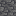 | `2` | **Stone & Rocks** | Click to browse Stone & Rocks |
|  | `3` | **Ores & Metals** | Click to browse Ores & Metals |
| 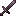 | `4` | **Tools & Weapons** | Click to browse Tools & Weapons |
| 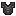 | `5` | **Armor Gear** | Click to browse Armor Gear |
| 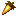 | `6` | **Food & Crops** | Click to browse Food & Crops |
| 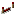 | `7` | **Redstone** | Click to browse Redstone |
|  | `8` | **Misc Supplies** | Click to browse Misc Supplies |
| 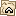 | `9` | **Abandoned Camp Map** | Category: misc<br>Buy price: $2.5K<br>Sell price: $2K<br>-------------------------<br>▶ Left-Click: Buy 1x<br>▶ Right-Click: Select quantity |
| 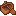 | `10` | **Acacia Boat** | Category: misc<br>Buy price: $4K<br>Sell price: $1K<br>-------------------------<br>▶ Left-Click: Buy 1x<br>▶ Right-Click: Select quantity |
| 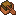 | `11` | **Acacia Boat with Chest** | Category: misc<br>Buy price: $3K<br>Sell price: $2.4K<br>-------------------------<br>▶ Left-Click: Buy 1x<br>▶ Right-Click: Select quantity |
|  | `12` | **Acacia Button** | Category: redstone<br>Buy price: $1.2K<br>Sell price: $200<br>-------------------------<br>▶ Left-Click: Buy 1x<br>▶ Right-Click: Select quantity |
|  | `13` | **Acacia Door** | Category: blocks<br>Buy price: $1.6K<br>Sell price: $400<br>-------------------------<br>▶ Left-Click: Buy 1x<br>▶ Right-Click: Select quantity |
|  | `14` | **Acacia Fence** | Category: blocks<br>Buy price: $1.2K<br>Sell price: $300<br>-------------------------<br>▶ Left-Click: Buy 1x<br>▶ Right-Click: Select quantity |
|  | `45` | **« Back** | Return to the previous screen |
|  | `47` | **Sell Chest** | Drop items in, close to sell |
|  | `49` | **Steve \| Profile** | Balance: $1M<br>($1,000,000)<br>-------------------------<br>Account active |
|  | `50` | **Page 2 »** | Next page |
|  | `51` | **Auction House** | Buy from other players |
|  | `53` | **Close** | Exit the catalog |
|  | `...` | **30 more dynamic entries** | Rendered in the same slots in-game. |

---

## 4. Search: Diamond (16)

**Opened by:** `/buy search diamond`  
**Inventory size:** 6 rows (54 slots)

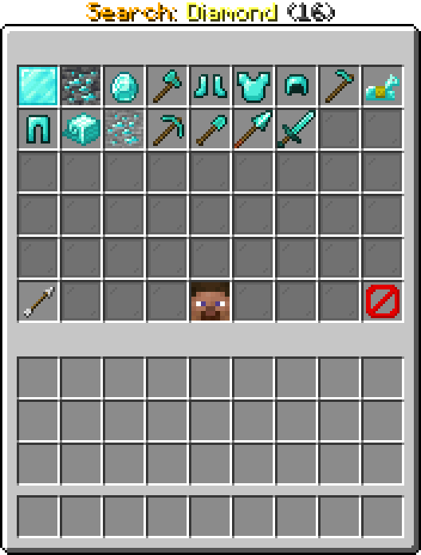

Search results for **diamond**. Every match is buyable and uses the same left-click / right-click actions as the catalog (16 matches).

| Icon | Slot | Item / control | Lore / action |
|:---:|:---:|:--|:--|
|  | `0` | **Block of Diamond** | Category: ores<br>Buy price: $270K<br>Sell price: $216K<br>-------------------------<br>▶ Left-Click: Buy 1x<br>▶ Right-Click: Select quantity |
| 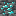 | `1` | **Deepslate Diamond Ore** | Category: ores<br>Buy price: $40K<br>Sell price: $32K<br>-------------------------<br>▶ Left-Click: Buy 1x<br>▶ Right-Click: Select quantity |
|  | `2` | **Diamond** | Category: misc<br>Buy price: $30K<br>Sell price: $24K<br>-------------------------<br>▶ Left-Click: Buy 1x<br>▶ Right-Click: Select quantity |
| 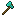 | `3` | **Diamond Axe** | Category: tools<br>Buy price: $40K<br>Sell price: $32K<br>-------------------------<br>▶ Left-Click: Buy 1x<br>▶ Right-Click: Select quantity |
|  | `4` | **Diamond Boots** | Category: armor<br>Buy price: $120K<br>Sell price: $96K<br>-------------------------<br>▶ Left-Click: Buy 1x<br>▶ Right-Click: Select quantity |
|  | `5` | **Diamond Chestplate** | Category: armor<br>Buy price: $240K<br>Sell price: $192K<br>-------------------------<br>▶ Left-Click: Buy 1x<br>▶ Right-Click: Select quantity |
|  | `45` | **« Back** | Return to previous screen |
|  | `49` | **Steve \| Profile** | Balance: $1M<br>($1,000,000)<br>-------------------------<br>Account active |
|  | `53` | **Close** | Close this menu |
|  | `...` | **10 more dynamic entries** | Rendered in the same slots in-game. |

---

## 5. Buy: Diamond Sword

**Opened by:** `Right-click a shop entry`  
**Inventory size:** 3 rows (27 slots)

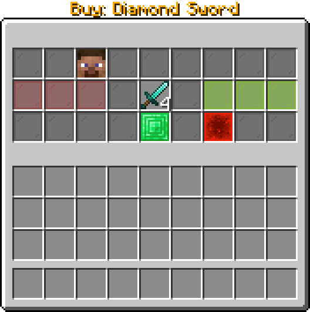

The quantity picker and purchase confirmation. The example is buying 4 Diamond Swords.

| Icon | Slot | Item / control | Lore / action |
|:---:|:---:|:--|:--|
|  | `2` | **Steve \| Profile** | Balance: $1M<br>($1,000,000)<br>-------------------------<br>Account active |
|  | `9` | **-64** | Reduce amount by 64 |
|  | `10` | **-8** | Reduce amount by 8 |
|  | `11` | **-1** | Reduce amount by 1 |
| 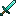 | `13` | **Diamond Sword x4** | Total cost: $160K<br>Price each: $40K |
|  | `15` | **+1** | Increase amount by 1 |
|  | `16` | **+8** | Increase amount by 8 |
|  | `17` | **+64** | Increase amount by 64 |
|  | `22` | **✔ Buy 4x for $160K** | Click to confirm purchase |
|  | `24` | **Cancel** | Go back |

---

## 6. Sell Chest (drop items, then close)

**Opened by:** `/sell`  
**Inventory size:** 6 rows (54 slots)

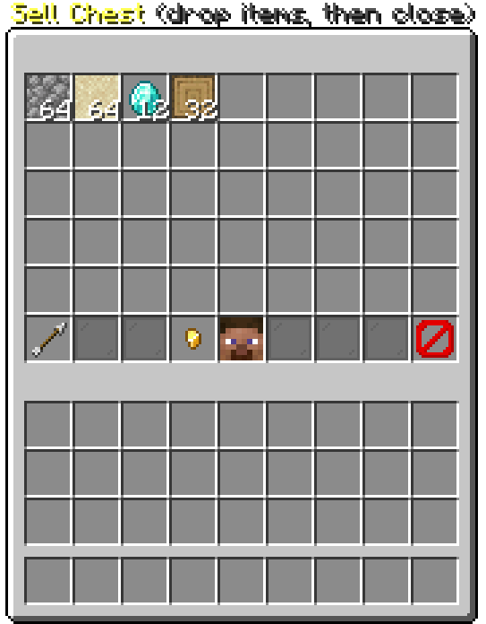

The sell chest. Slots 0-44 are a normal drop area; the preview updates as items are placed. Closing the inventory sells everything and returns items the shop does not buy.

| Icon | Slot | Item / control | Lore / action |
|:---:|:---:|:--|:--|
| 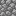 | `0` | **Cobblestone** | Category: blocks<br>Buy price: $10<br>Sell price: $8 |
|  | `1` | **Sand** | Category: blocks<br>Buy price: $10<br>Sell price: $8 |
|  | `2` | **Diamond** | Category: misc<br>Buy price: $30K<br>Sell price: $24K |
|  | `3` | **Oak Log** | Category: blocks<br>Buy price: $800<br>Sell price: $600 |
|  | `45` | **« Back** | Return to previous screen<br>Items placed are sold on close |
|  | `48` | **Sale preview** | Sellable items: 172<br>You will receive: $308.2K<br>Close the chest to sell |
|  | `49` | **Steve \| Profile** | Balance: $1M<br>($1,000,000)<br>-------------------------<br>Account active |
|  | `53` | **Close & Sell** | Closing sells everything placed |

---

## 7. Auction House (1/1)

**Opened by:** `/ah`  
**Inventory size:** 6 rows (54 slots)

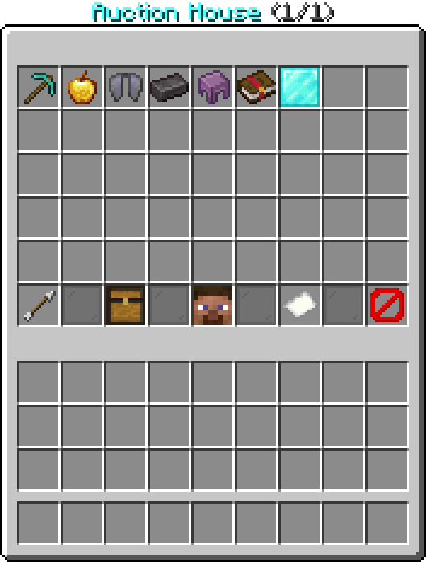

The auction browser. Listings fill slots 0-44; the control row shows collection, selling help and navigation. The sample shows seven listings.

| Icon | Slot | Item / control | Lore / action |
|:---:|:---:|:--|:--|
| 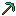 | `0` | **Diamond Pickaxe** | -------------------------<br>Price: $45K<br>Seller: Alex<br>Expires in: 47h 12m<br>▶ Click to buy |
|  | `1` | **Golden Apple** | -------------------------<br>Price: $12K<br>Seller: Steve<br>Expires in: 31h 5m<br>▶ Click to buy |
|  | `2` | **Elytra** | -------------------------<br>Price: $250K<br>Seller: Nova<br>Expires in: 18h 44m<br>▶ Click to buy |
| 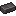 | `3` | **Netherite Ingot** | -------------------------<br>Price: $60K<br>Seller: Kai<br>Expires in: 9h 3m<br>▶ Click to buy |
| 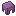 | `4` | **Shulker Shell** | -------------------------<br>Price: $18K<br>Seller: Mika<br>Expires in: 2h 39m<br>▶ Click to buy |
|  | `5` | **Enchanted Book** | -------------------------<br>Price: $32K<br>Seller: Rune<br>Expires in: 46h 2m<br>▶ Click to buy |
|  | `45` | **« Back** | Return to previous screen |
| 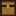 | `47` | **Collect items** | Waiting for you: 2<br>(expired or cancelled listings)<br>▶ Click to collect |
|  | `49` | **Steve \| Profile** | Balance: $1M<br>($1,000,000)<br>-------------------------<br>Account active |
|  | `51` | **How to sell** | Hold an item and run:<br>/ah sell <price><br>Prices accept suffixes: 1k, 2.5m |
|  | `53` | **Close** | Close this menu |
|  | `...` | **1 more dynamic entries** | Rendered in the same slots in-game. |

---

## 8. Confirm purchase

**Opened by:** `Click a listing in /ah`  
**Inventory size:** 3 rows (27 slots)

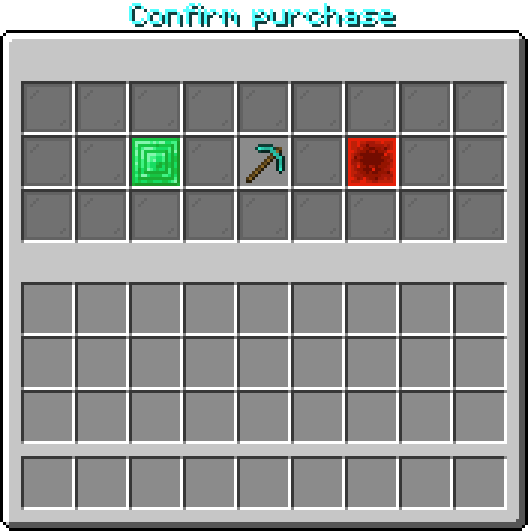

The auction purchase confirmation for a 45,000 coin Diamond Pickaxe listed by **Alex**.

| Icon | Slot | Item / control | Lore / action |
|:---:|:---:|:--|:--|
|  | `11` | **✔ Buy for $45K** | Your balance: $1M |
|  | `13` | **Diamond Pickaxe** | -------------------------<br>Price: $45K<br>Seller: Alex<br>Expires in: 47h 12m<br>▶ Click to buy |
|  | `15` | **Cancel** | Go back |

---

## Regenerating These Images

```bash
# 1. Download the client jar (never committed)
.agent-work/tools/fetch_client_jar.sh 26.3

# 2. Refresh item icons and docs/PRICE.md
python3 .agent-work/tools/generate_price_docs.py \
  --jar .agent-work/tmp/mc/client.jar \
  --version 26.3 \
  --prices src/main/resources/prices.tsv \
  --docs docs

# 3. Render the GUIs and build docs/GUI.md
python3 .agent-work/tools/generate_gui_docs.py \
  --jar .agent-work/tmp/mc/client.jar \
  --version 26.3 \
  --prices src/main/resources/prices.tsv \
  --docs docs
```

_Generated from the plugin sources and the Minecraft client assets. Do not edit the screenshots by hand; change the Java GUI code or the generator instead._
